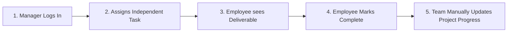

# TaskFlow — Modern Corporate Task & Workflow Management

A premium, demo-ready corporate task management web application built with **React**, **TypeScript**, and **Tailwind CSS**. Engineered with Linear-grade design polish, rich emerald/mint/slate aesthetics, real-time presence indicators, role-based workflows, independent task orchestration, and manual project progress controls for team members and managers.

---

## 🌟 The 5-Step Main Demo Story

TaskFlow is pre-seeded and configured to demonstrate the core workflow in under 60 seconds:



1. **Step 1 — Manager Logs In**:
   - In the top header bar (or via the **Demo Persona** switcher), select **Manager** (Sarah Jenkins — Head of Product & Operations).
   - View team presence (Online/Break/Offline), task completion rate, and project health cards.

2. **Step 2 — Manager Creates & Assigns an Independent Task**:
   - Click the emerald **"+ New Task"** or **"Assign New Task"** button.
   - Enter a title (e.g., *"Audit SOC2 RBAC matrix & sign off"*).
   - Select **Assignee**: **Alex Morgan** (Employee).
   - Note: Tasks are independent deliverables and are assigned directly to team members without project coupling.
   - Click **"Assign Task"**. Toast confirms assignment and activity feed updates.

3. **Step 3 — Employee Sees Deliverable**:
   - In the top header bar, click **"Employee"** to switch persona to **Alex Morgan** (Senior Product Designer).
   - Notice that "+ New Task" creation is restricted to Managers.
   - Alex sees the assigned deliverable in the priority alert banner and in "Your Deliverables".

4. **Step 4 — Employee Marks Task Complete**:
   - On Alex's dashboard or in the **Tasks** board, click the circular checkmark on the deliverable.
   - Enjoy the celebratory confetti animation!
   - The task immediately updates to **"Completed"**.

5. **Step 5 — Employee & Manager Manually Update Project Progress**:
   - Open **"Projects"** (or use the Project station on the dashboard).
   - Both employees and managers can manually adjust progress for each project (using interactive 0–100% sliders or `+5%` / `-5%` steppers).
   - Notice that each adjustment logs an audit trail: *"Updated by [Name] • Just now"*.

---

## 🚀 Quick Start Guide

### Prerequisites
- **Node.js** (v18.0.0 or later)
- **npm** (v9.0.0 or later)

### Installation & Launch
```bash
# 1. Install dependencies
npm install

# 2. Start development server
npm run dev
```

Open your browser at `http://localhost:3000` (or the port displayed in your terminal).

---

## 📱 Progressive Web App (PWA) & Mobile Application

TaskFlow is engineered as a **Progressive Web App (PWA)** and **Hybrid Mobile Application**:

### 1. Mobile & Standalone PWA Capabilities
- **Install on iOS (iPhone / iPad)**: Open in Safari, tap the **Share** button (`⎋`), and select **"Add to Home Screen"** (`⊞`). The app runs in standalone fullscreen mode without browser URL bars.
- **Install on Android**: Open in Chrome/Edge. Tap **"Install App"** from the in-app prompt banner or the browser menu (⋮) to install a native launcher icon.
- **Offline Resilience**: The registered Service Worker (`public/sw.js`) pre-caches core assets, enabling the app to load and function locally even when disconnected. An offline banner notifies users of local cache operation.
- **Haptic Feedback**: Native tactile vibrations via the Vibration API on navigation and task completions.
- **Mobile Safe Area**: Supports iPhone notch, dynamic island, and Android gesture navigation bars via CSS `env(safe-area-inset-top)` and `env(safe-area-inset-bottom)`.

### 2. Native Mobile App Packaging (Capacitor)
TaskFlow includes `capacitor.config.ts` pre-configured for native builds:
```bash
# 1. Build web production bundle
npm run build

# 2. Add Android or iOS native platforms
npx cap add android
npx cap add ios

# 3. Sync code and launch Android Studio / Xcode
npx cap sync
npx cap open android
```

---

## 🎨 Visual Design System & Palette

- **Primary Actions & Active States**: Deep emerald & forest green (`#064e3b`, `#047857`, `#059669`)
- **Success & Subtle Highlights**: Soft mint green (`#ecfdf5`, `#d1fae5`, `#a7f3d0`)
- **Navigation & Text**: Charcoal and slate (`#0f172a`, `#1e293b`, `#334155`)
- **Cards & Surfaces**: Pure white cards on subtle slate background (`#f8fafc`)
- **"On Break" Status & At-Risk Alerts**: Warm amber (`#f59e0b`, `#fef3c7`)
- **Overdue or Blocked Work**: Rose/red (`#ef4444`, `#fee2e2`)

---

## 👥 Demo Role Personas

| Persona | Name | Role & Department | Core Capabilities |
| :--- | :--- | :--- | :--- |
| **Manager** | Sarah Jenkins | Head of Product & Operations | Team overview, task assignment & reassignment, project progress observation, team presence tracking |
| **Employee** | Alex Morgan | Senior Product Designer | "My Tasks" focus view, presence status toggle (Online, On Break, Offline), task completion, activity feed |
| **Developer** | David Chen | Lead Systems Architect | Platform engineering overview, system metrics, infrastructure sprint tasks |

---

## 🛠️ Key Features

1. **Role Switcher & Interactive Guide**:
   - 1-click persona switcher right in the top navigation header for seamless presentation.
   - Comprehensive Welcome Modal with detailed breakdown of capabilities.

2. **Manual Project Progress Controls**:
   - Both employees and managers can manually update project progress percentages (0–100%) and project health (On Track, At Risk, Behind).
   - Interactive visual sliders, milestone presets (25%, 50%, 75%, 100%), and quick +5%/-5% nudges on project cards.
   - Preserves an audit trail of who updated each project and when.

3. **Live Employee Presence System**:
   - Teammates can be **Online** (green with live pulse), **On Break** (amber), or **Offline** (slate).
   - Users can update their availability from the header dropdown, dashboard, team directory, or settings.

4. **Independent Task Management**:
   - Tasks are completely independent deliverables assigned directly to employees.
   - Managers create, prioritize, and assign tasks; employees execute and mark work complete.
   - **Kanban Board** (To Do, In Progress, Blocked, Completed) and **List/Table** view toggle.
   - Filter by Status, Assignee, Priority (Urgent, High, Medium, Low), and Keyword search.
   - Task detail modal with editing, reassignment, and completion controls.

5. **Lightweight Chat Preview**:
   - Project channels (`#general`, `#product-launch`, `#engineering-sync`) and Direct Messages.
   - Live simulated messaging thread with sending capability.
   - "Real-time sync coming soon via WebSockets" banner.

6. **Local Persistence & Instant Reset**:
   - All tasks, presence changes, and activities persist across page reloads via `localStorage`.
   - Settings page includes a **"Reset All Data to Initial Demo State"** button to restart fresh whenever needed.

---

## 📁 Project Architecture

```
Taskflow/
├── public/
├── src/
│   ├── components/
│   │   ├── common/
│   │   │   ├── CreateTaskModal.tsx      # Modal to create & assign tasks
│   │   │   ├── GlobalSearchModal.tsx    # ⌘K quick search overlay
│   │   │   ├── PresenceBadge.tsx        # Online / On Break / Offline pills
│   │   │   ├── PriorityBadge.tsx        # Urgent, High, Medium, Low pills
│   │   │   ├── RoleBadge.tsx            # Manager, Employee, Dev tags
│   │   │   ├── RoleSwitcherModal.tsx    # Welcome screen & persona selector
│   │   │   ├── StatusBadge.tsx          # Status indicators
│   │   │   ├── TaskDetailModal.tsx      # Task inspection & editing modal
│   │   │   └── Toast.tsx                # Floating status notifications
│   │   └── layout/
│   │       ├── Header.tsx               # Top navigation with role switcher
│   │       ├── MobileNav.tsx            # Drawer & bottom tab bar
│   │       └── Sidebar.tsx              # Desktop corporate sidebar
│   ├── context/
│   │   └── AppContext.tsx               # Reactive state & localStorage store
│   ├── data/
│   │   └── mockData.ts                  # Seeded corporate users, tasks, projects
│   ├── pages/
│   │   ├── Dashboard.tsx                # Role-aware dashboard
│   │   ├── MessagesPage.tsx             # Lightweight chat preview
│   │   ├── ProjectsPage.tsx             # Project grid & detail views
│   │   ├── SettingsPage.tsx             # Settings & reset demo button
│   │   ├── TasksPage.tsx                # Kanban board & table views
│   │   └── TeamPage.tsx                 # Presence directory & workload
│   ├── types/
│   │   └── index.ts                     # TypeScript definitions
│   ├── App.tsx                          # Root layout & view router
│   ├── index.css                        # Tailwind tokens & custom styles
│   └── main.tsx                         # React entrypoint
├── index.html
├── package.json
├── postcss.config.js
├── tailwind.config.js
├── tsconfig.json
├── tsconfig.node.json
└── vite.config.ts
```
